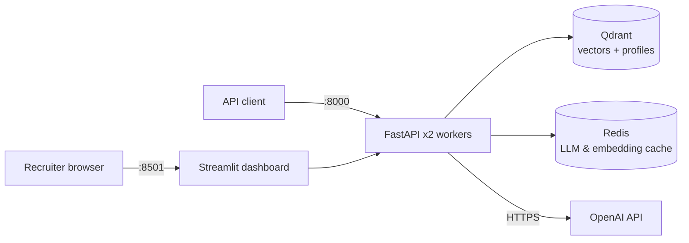
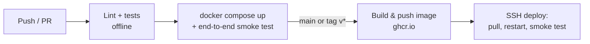

# AI Resume Matcher

[](https://github.com/Hassan-essoufi/resume-matcher/actions/workflows/ci.yml)
[](https://github.com/Hassan-essoufi/resume-matcher/actions/workflows/cd.yml)

AI Resume Matcher ranks candidates against a job description and explains every score.

Upload a job description and a batch of resumes (PDF, DOCX or TXT). The system removes personal data, extracts a structured profile from each document with an LLM, shortlists candidates by semantic similarity, and scores each one with a transparent formula. Every ranked candidate comes with a short explanation a recruiter can act on.

## Table of contents

- [How it works](#how-it-works)
- [Architecture](#architecture)
- [Getting started](#getting-started)
- [Configuration](#configuration)
- [API usage](#api-usage)
- [Deployment and CI/CD](#deployment-and-cicd)
- [Evaluation and fairness](#evaluation-and-fairness)
- [Troubleshooting](#troubleshooting)
- [Project structure](#project-structure)
- [Commands](#commands)

## How it works

```mermaid
flowchart LR
    U[Job description + resumes<br/>PDF / DOCX / TXT] --> I[1. Ingestion<br/>text extraction + cleaning]
    I --> P[2. PII scrubbing<br/>Presidio + regex]
    P --> X[3. LLM extraction<br/>OpenAI structured outputs]
    X --> E[4. Embeddings<br/>text-embedding-3-small]
    E --> Q[(Qdrant)]
    Q --> R[5. Retrieval<br/>top-K semantic shortlist]
    R --> S[6. Explainable scoring<br/>skills + experience + semantic]
    S --> L[7. LLM explanation<br/>grounded in the scores]
    L --> O[Ranked shortlist<br/>API + dashboard]
```



| Step | What happens | Why |
|---|---|---|
| **Ingestion** | PDF, DOCX and TXT files are converted to clean text. | Real resumes come in many formats. |
| **PII scrubbing** | Names, emails, phone numbers and links are replaced with placeholders such as `<NAME>` and `<EMAIL>`. | Protects privacy (GDPR, Moroccan law 09-08) and reduces bias: the model never sees who the candidate is. |
| **LLM extraction** | Resumes yield skills, years of experience, seniority and job titles. Jobs yield required skills, nice-to-have skills and minimum experience. | Structured outputs guarantee valid JSON that matches a Pydantic schema. |
| **Skill normalization** | Aliases are mapped to one name (`k8s` → `kubernetes`, `sklearn` → `scikit-learn`), and close synonyms are matched by embedding similarity. | Skills written differently are compared fairly. |
| **Retrieval** | Qdrant returns the top-K resumes closest to the job. | Scales to thousands of resumes. |
| **Scoring** | A weighted formula combines the extracted features (see below). | Every point of the score can be justified to a recruiter. |
| **Explanation** | The LLM writes strengths, gaps and a recommendation using only the computed facts. | Explanations stay grounded in the scores. |

### Scoring formula

```
score = 100 × ( 0.35 × semantic similarity
              + 0.40 × required skills covered
              + 0.10 × nice-to-have skills covered
              + 0.15 × experience fit )
```

The weights are configurable and can be tuned on labeled data with `make eval`.

A transparent formula is used instead of a trained ranking model. Training a ranker requires thousands of real hiring decisions, which are rarely available and often encode past human bias. A formula over LLM-extracted features is easier to audit, explain and adjust, which matters in a sensitive domain such as hiring.

## Architecture

The full stack starts with a single command: `docker compose up -d`.



| Service | Role | Exposed |
|---|---|---|
| **api** | FastAPI service with 2 workers, API-key authentication and a health check | Port 8000 |
| **ui** | Streamlit recruiter dashboard | Port 8501 |
| **qdrant** | Vector database, protected by an API key, with a persistent volume | Private network only |
| **redis** | Password-protected shared cache with TTL, persistence and LRU eviction at 512 MB | Private network only |

### Production features

- **Security:** Qdrant and Redis are never exposed and require credentials. Every data endpoint requires an API key. Containers run as a non-root user. Uploaded files are checked for type and size.
- **Privacy:** Personal data is removed before storage and before any LLM call. Raw files are never stored. `DELETE /resumes/{id}` supports the right to erasure.
- **Cost control:** LLM and embedding results are cached in Redis by content hash and shared by all workers, so the same text is never billed twice. Cached entries expire automatically.
- **Resilience:** Services start in order behind health checks and restart automatically. OpenAI calls use retries and timeouts. The API keeps working if Redis is down. A failed explanation never breaks a ranking, and one bad file never fails a batch upload.
- **Observability:** Every request is logged with a request ID and latency. LLM token usage is logged. Container logs are rotated.
- **Idempotency:** Re-uploading a file updates the existing record instead of creating a duplicate.

## Getting started

### Prerequisites

- **Docker** with Docker Compose v2. On Windows and macOS, Docker Desktop must be running.
- **An OpenAI API key with available credits.** API usage is billed separately from ChatGPT subscriptions. Add credits under [Billing](https://platform.openai.com/settings/organization/billing/) before you start. Without a key, the app runs in [offline mode](#offline-mode).
- **About 2 GB of free RAM** and free ports **8000** and **8501**.
- **Internet access** during the build, to download Python packages and the spaCy language model.

### Installation

```bash
git clone https://github.com/Hassan-essoufi/resume-matcher.git
cd resume-matcher
cp .env.example .env
```

Edit `.env`:

1. Set `OPENAI_API_KEY` to your OpenAI key.
2. Replace each `change-me` value (`API_KEY`, `REDIS_PASSWORD`, `QDRANT_API_KEY`) with a random secret, for example from `openssl rand -hex 24`.

Then start the stack and verify it:

```bash
make up       # docker compose up -d --build --wait
make smoke    # end-to-end test against the running stack
```

`make smoke` uploads the sample resumes, creates a job and checks the ranking. It must print `SMOKE TEST PASSED`.

- Dashboard: `http://localhost:8501`
- API documentation: `http://localhost:8000/docs`

## Configuration

All settings are read from `.env`. See `.env.example` for the full list.

| Variable | Default | Description |
|---|---|---|
| `OPENAI_API_KEY` | *(empty)* | OpenAI key. Leave empty to run in offline mode. |
| `LLM_MODEL` | `gpt-4.1-mini` | Model used for extraction and explanations. |
| `EMBEDDING_MODEL` | `text-embedding-3-small` | Model used for embeddings. |
| `API_KEY` | *(empty)* | Key that clients must send in the `X-API-Key` header. Empty disables authentication. |
| `REDIS_PASSWORD` | — | Redis password. |
| `QDRANT_API_KEY` | — | Qdrant API key. |
| `CACHE_TTL_DAYS` | `30` | Lifetime of cached LLM and embedding results. |
| `W_SEMANTIC`, `W_REQUIRED`, `W_NICE`, `W_EXPERIENCE` | `0.35`, `0.40`, `0.10`, `0.15` | Scoring weights. They must sum to 1. |
| `IMAGE` | `resume-matcher:local` | Docker image to run. CD sets this to the pushed image. |

### Offline mode

When `OPENAI_API_KEY` is empty, the app makes no external calls. It uses rule-based skill extraction, local hashing embeddings and template-based explanations. `/health` then reports `"llm": "offline"`.

Offline mode needs no credits and is used by the test suite. Ranking quality is lower than with the LLM pipeline, so use OpenAI for real hiring decisions.

## API usage

```bash
H="X-API-Key: <your API_KEY>"
URL=http://localhost:8000

curl -H "$H" -F "files=@data/sample/resumes/cv01.txt" -F "files=@data/sample/resumes/cv06.txt" $URL/resumes
curl -H "$H" -F "file=@data/sample/jobs/ml_engineer.txt" $URL/jobs        # returns a job_id
curl -H "$H" "$URL/jobs/<job_id>/matches?top_n=5"
```

| Method | Endpoint | Description |
|---|---|---|
| `GET` | `/health` | Service status, record counts, LLM mode and cache status |
| `POST` | `/resumes` | Upload one or more resumes |
| `POST` | `/jobs` | Upload a job description |
| `GET` | `/jobs/{job_id}/matches` | Ranked candidates with score breakdown and explanation |
| `DELETE` | `/resumes/{resume_id}` | Permanently delete a resume |

Example result (illustrative):

```json
{
  "rank": 1, "filename": "cv01.txt", "score": 91.5,
  "breakdown": {
    "semantic": 0.82, "required_coverage": 1.0, "nice_coverage": 0.67, "experience_fit": 1.0,
    "matched_required": ["python", "pytorch", "scikit-learn", "llm", "rag", "vector databases", "docker", "fastapi"],
    "missing_required": []
  },
  "explanation": {
    "strengths": ["Covers all required skills including RAG and vector databases", "4 years of ML experience"],
    "gaps": ["No Kubernetes experience (nice to have)"],
    "summary": "Strong match, interview first."
  }
}
```

## Deployment and CI/CD

### Deploying to a server

On any Linux server with Docker, follow [Installation](#installation). For public access, put ports 8000 and 8501 behind HTTPS with your cloud provider's load balancer or a reverse proxy.

### Pipeline



- **CI** (`.github/workflows/ci.yml`) runs on every push and pull request. It runs ruff, the offline pytest suite and an evaluation smoke run. It then starts the full stack with Docker Compose, runs the end-to-end test and checks both published ports. No secrets are required.
- **CD** (`.github/workflows/cd.yml`) runs on `main` and on version tags. It re-runs CI and builds the image. It pushes the image to GitHub Container Registry, tagged `latest`, with the commit SHA and with the version. It then deploys to your server over SSH (`docker compose pull` and `up --wait`) and runs the smoke test in production. Deployments never run in parallel.

To enable deployment, add these repository secrets: `DEPLOY_HOST`, `DEPLOY_USER`, `DEPLOY_SSH_KEY` and `DEPLOY_PATH`. Without them, images are still built and pushed, and the deploy step is skipped. The server needs its own `.env`, with an OpenAI key that has credits.

### Rollback

Set `IMAGE=ghcr.io/<owner>/resume-matcher:<previous-sha>` in `.env` on the server, then run `docker compose up -d --no-build`.

## Evaluation and fairness

### Ranking quality

`make eval` compares three systems on labeled job/resume pairs with graded relevance from 0 to 3:

| System | Description |
|---|---|
| `keyword_tfidf` | TF-IDF similarity, similar to a classic keyword-based ATS |
| `semantic_only` | Embedding similarity only |
| `full_pipeline` | LLM extraction, embeddings and explainable scoring |

The metrics are **NDCG@3** and **Precision@3**. Results are written to `eval/results.md`. The sample data in `data/sample/` is small and fictional. Add your own labeled data for stronger conclusions.

### Fairness

`make fairness` runs a name-swap test. The same resume is scored under 8 names that vary in gender and origin, and a fair system returns the same score every time. The test runs with PII scrubbing both on and off to measure its effect.

## Troubleshooting

### Every upload fails with `processing failed`

Check the API logs:

```bash
docker compose logs api --tail=100
```

If the logs show `429` with `insufficient_quota` or `credit_balance_exhausted`, your OpenAI account has no credits left. The rest of the stack is working: `/health` and the dashboard respond normally, but every LLM call is rejected. To fix it:

1. Add credits under [Billing](https://platform.openai.com/settings/organization/billing/).
2. Run `make restart`, then `make smoke`.

If you cannot add credits, clear `OPENAI_API_KEY` to run in [offline mode](#offline-mode).

A `401` error means the key is invalid or revoked. Create a new key at [platform.openai.com/api-keys](https://platform.openai.com/api-keys).

### Errors after switching between OpenAI and offline mode

OpenAI embeddings have 1536 dimensions and offline embeddings have 512. Qdrant collections are created with a fixed size, so data stored in one mode cannot be used in the other. After you add or remove `OPENAI_API_KEY`, reset the stored data and start again:

```bash
docker compose down -v    # also deletes all stored resumes, jobs and cached results
make up
```

Then upload your resumes and jobs again.

### Docker cannot connect to the engine

Errors such as `cannot find the file specified` or `Cannot connect to the Docker daemon` mean the Docker engine is not running. Start Docker Desktop, or start the Docker service on Linux, and retry.

### A port is already in use

Change `API_PORT` or `UI_PORT` in `.env`, for example `UI_PORT=8502`, then run `make up`.

## Project structure

```
matcher/
  ingestion.py     PDF / DOCX / TXT to clean text
  pii.py           personal data removal (Presidio + regex)
  llm.py           OpenAI structured extraction, explanations, embeddings
  cache.py         Redis cache
  extraction.py    OpenAI extractor + rule-based fallback
  skills.py        skill vocabulary and normalization
  embeddings.py    OpenAI embeddings (+ offline hashing embedder)
  vector_store.py  Qdrant (+ in-memory store for tests)
  scoring.py       explainable score
  engine.py        the pipeline
api/main.py        FastAPI service
ui/app.py          Streamlit recruiter dashboard
scripts/           end-to-end smoke test (CI and after each deploy)
.github/workflows/ ci.yml (tests + compose e2e), cd.yml (build, push, deploy)
eval/              ranking evaluation + fairness test
tests/             unit, pipeline and API tests (offline)
```

## Commands

| Command | Description |
|---|---|
| `make up` | Build and start the stack |
| `make down` | Stop the stack (data volumes are kept) |
| `make restart` | Restart the API and dashboard |
| `make logs` | Follow the logs |
| `make ps` | Show service status |
| `make smoke` | Run the end-to-end test against the running stack |
| `make eval` | Measure ranking quality against baselines (writes `eval/results.md`) |
| `make fairness` | Run the name-swap fairness test |
| `make test` | Run the unit tests locally (offline, no API key needed) |
| `make lint` | Run ruff |
